<div align="center">




</div>

---

### 🥀 `whoami`

```text
name    : Fierlansyah Krishna Desfarro (Fier)
study   : Informatics Engineering Education @ UNY
focus   : Android (Kotlin / Java) · Web (PHP / MySQL)
```

---

### ⚔️ Arsenal

<p>


</p>

---

### 🗡️ Projects

| | Project | What it does | Stack |
|:-:|---|---|---|
| 🦐 | **Rumah Udang ERP**<br><sub>Industrial internship · PT Ayu Bumi Sejati · 2026</sub> | Android front end for a restaurant ERP: Kiosk, Cashier, Waiter, Kitchen Display and Warehouse modules, wired together so orders flow to the right kitchen station.<br><sub>🔒 Source code is confidential to the company.</sub> | Kotlin / Java · Android Studio · Figma |
| 🎼 | [**Musikaly Store**](https://github.com/FFFzensky/musikaly-store)<br><sub>Team project · 2025–26</sub> | Point-of-sale & inventory web app for a music store with owner, admin and cashier roles, receipts and sales charts. | PHP · MySQL · Bootstrap · Chart.js |
| 📖 | [**EDUVEL**](https://azizyco.github.io/EduvelProject/Project%20Eduvel/index.html)<br><sub>Team project · programmer & script writer</sub> | Educational visual novel for high-school informatics, with story choices, quizzes and puzzles. | Ren'Py (Python) |
| 🎭 | [**Ave Mujica Fan Website**](https://github.com/FFFzensky/ave-mujica-fansite) | Gothic fan site with accounts and per-page comments. | PHP · MySQL · HTML · CSS · JS |

---

### 📫 Contact

<a href="mailto:fierlansyahkrishnadesfarro@gmail.com"></a>

<div align="center">


</div>
